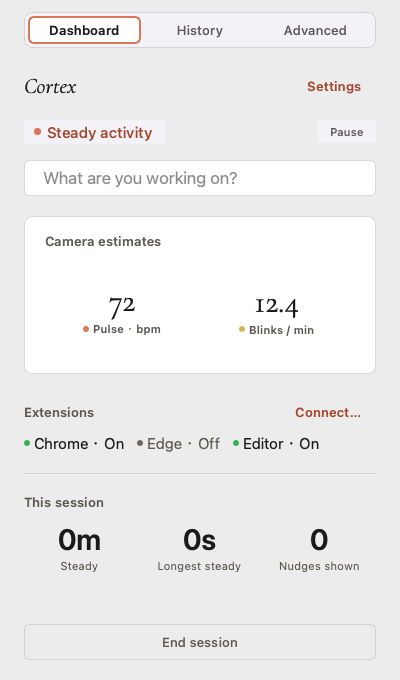
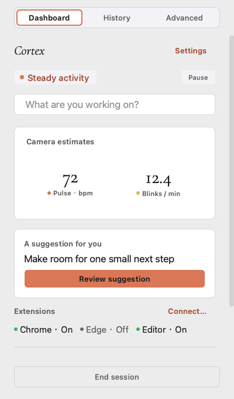
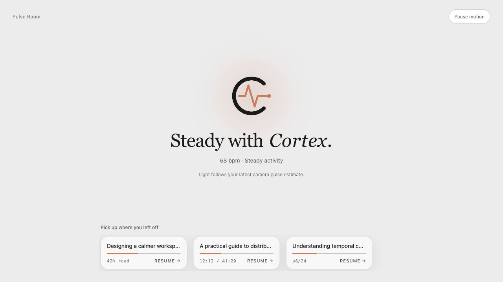
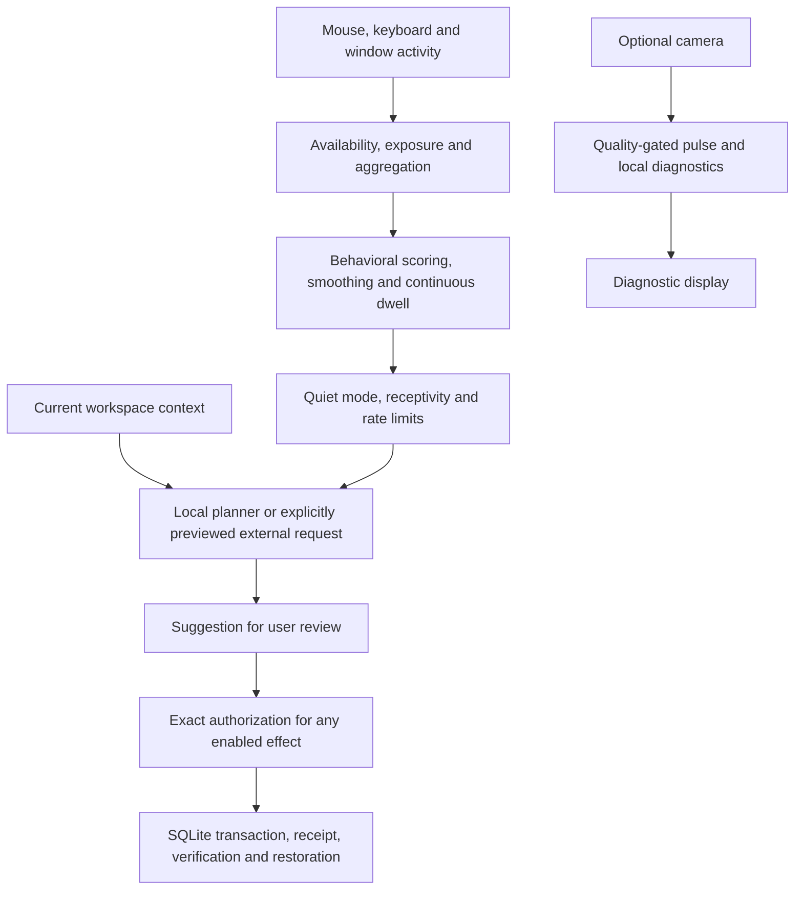

<p align="center">
  
</p>

<h1 align="center">Cortex — A Local Workspace Support Engine</h1>

<p align="center">
  A macOS research prototype that uses local activity and workspace context to offer conservative, user-controlled suggestions, with optional experimental camera estimates.
</p>

<p align="center">
  <a href="https://github.com/StevenWang-CY/cortex/actions/workflows/ci.yml">
    
  </a>
  <a href="https://github.com/StevenWang-CY/cortex/releases/latest">
    
  </a>
  <a href="LICENSE"></a>
  
  
  
  
  
</p>

<p align="center">
  <a href="https://github.com/StevenWang-CY/cortex/releases/latest">Download DMG</a> &nbsp;·&nbsp;
  <a href="docs/README.md">Documentation</a> &nbsp;·&nbsp;
  <a href="audit/findings.md">Audit ledger</a> &nbsp;·&nbsp;
  <a href="docs/implementation-2026-10.md">Current implementation</a> &nbsp;·&nbsp;
  <a href="CHANGELOG.md">Changelog</a> &nbsp;·&nbsp;
  <a href="cortex/docs/apis.md">API reference</a>
</p>

---

## In the app

Rendered examples from the current interface use synthetic readings and demo
context. They illustrate interaction and layout, not physiological accuracy.

<table>
  <tr>
    <td width="50%" align="center" valign="top">
      
      <br/><sub><b>Desktop dashboard</b><br/>Explicit signal status and reachable session controls</sub>
    </td>
    <td width="50%" align="center" valign="top">
      
      <br/><sub><b>Suggestion review</b><br/>Keyboard access without unsolicited focus</sub>
    </td>
  </tr>
</table>

<p align="center">
  
  <br/><sub><b>Pulse Room</b> · Fresh estimates, optional ambient motion, and workspace resume cards</sub>
</p>

## Current development status

The October refinement is implemented on the `0.5.0` development line, with
behavioral model `2.5.0` and feature schema `support-features-v2.2.0`.
The [implementation and evidence record](docs/implementation-2026-10.md)
explains the reproduced defects, alternatives considered, and final checks.

- **Validated locally:** 3,305 Python tests, 360 browser tests and 131 VS Code
  tests; strict lint/type/contract checks; Chrome/Edge builds; mounted arm64
  DMG verification; two clean packaged launches and shutdowns against the same
  isolated profile. Python branch-aware coverage is 69.32%.
- **Release boundary:** this run produced an ad-hoc arm64 development build.
  It did not publish a release, notarize the app, validate Intel hardware, or
  establish physical camera/TCC/VoiceOver or physiological accuracy results.
  The release badge and download link describe published tags, not unpublished
  builds.
- **Dependency status:** local arm64 Python and VS Code audits passed with no
  findings at review time; the browser build chain retains eleven reviewed
  exceptions: nine low/moderate, and two high build-tool advisories with no
  patched release. See [limitations](docs/limitations.md) and the
  [release requirements](docs/release/README.md).

---

## Engineering highlights

- **Schema codegen drift gate.** Pydantic models in
  [`cortex/libs/schemas/`](cortex/libs/schemas/) are the single source
  of truth for every shape that crosses the daemon ↔ browser-extension
  boundary; a custom generator emits TypeScript declarations for both browser
  and VS Code clients. Stale
  generated output is rejected by **both** the pre-commit hook and a
  CI job. Runtime validators still enforce payload and authority boundaries.
- **Observed evidence and continuous dwell.** Input-source availability is
  distinct from observed inactivity. Missing sources abstain, duplicate or
  regressed timestamps do not amplify smoothing, and observation gaps reset
  inference dwell. The versioned model digest includes acquisition,
  aggregation, fusion and smoothing.
- **Capability-token auth, end-to-end correlation IDs.** Every
  mutating HTTP route and the WebSocket handshake gate on a 256-bit
  token (`mode 0600` at `~/Library/Application Support/Cortex/auth.token`,
  rotatable from the UI). Each mutating request is assigned an
  `X-Cortex-Request-ID` that surfaces in dashboard error toasts so
  users can quote the cid back when filing issues.
- **Research policy instrumentation.** The repository contains contextual
  policy and propensity-logging experiments. Their current reports are
  diagnostics, not causal evidence, and production defaults do not grant
  them workspace authority.
- **Conservative physiology boundary.** Quality-gated webcam pulse can be
  displayed as an experimental wellness signal. Camera-derived HRV,
  respiration, LF/HF, apnea, and the former stress-integral trigger are
  unavailable until metric-specific reference-sensor validation passes.
- **Bounded, client-safe stop chain.** Stopping the daemon executes
  WebSocket `SHUTDOWN` → authenticated HTTP `/shutdown` → a bounded wait
  for the daemon's own graceful shutdown (recap, receipts, database close)
  → SIGTERM of the daemon process identified by its pidfile or listening
  socket → SIGKILL survivors. Browser and editor processes that merely hold
  a client socket are excluded from process targeting. The browser drains an
  interrupted launch before stopping, keeps restoration receipts available,
  and displays success only after the helper verifies exit. The lifecycle invariants are
  documented in [`AGENTS.md`](AGENTS.md) and tested on the shutdown paths.
- **Hard CI gates.** Python lint/type/tests, schema and version drift,
  browser type/tests/build, VS Code compile/tests/package, regression
  replay, and dependency-policy artifacts run on changes before release.
- **Cross-language stack** with intent: Python (FastAPI + PySide6) ·
  TypeScript (Plasmo MV3 + VS Code) · C (`.cortex_launcher.c` for
  the legacy macOS TCC wrapper).
- **Bounded task ownership.** Coordinators retain live tasks through cleanup
  deadlines and keep bounded completion records without retaining historical
  task results or tracebacks.
- **Documented implementation.** The [current specification](docs/implementation-2026-10.md)
  records the completed algorithm/runtime/UI refinement and verification;
  [IMPLEMENTATION.md](IMPLEMENTATION.md) preserves earlier engineering history.

---

## Key features

- **Local sensing** — quality-gated pulse plus blink, head-pose, and input/window telemetry. Missing or poor-quality camera data degrades explicitly.
- **Evidence-aware support estimates** — fixed-denominator behavior scores,
  explicit unknown/warm-up states, provenance, coverage, and a fail-closed
  rollback; never calibrated probabilities or diagnoses.
- **Preview-gated LLM proposals** — model networking is off by default. In
  external mode, the user inspects one exact redacted payload and provider
  caveat, confirms it once, and receives a locally validated proposal.
- **LeetCode mode** — DOM observer, stage inference (READ / PLAN / IMPLEMENT / DEBUG / REFLECT), user-controlled stuck-state support, pattern-ladder hints, and submission review.
- **Suggestion-only authority** — fresh and migrated installs cannot mutate tabs, editors, windows, or files from a proposal. Enabled effects require exact manifest authorization, durable receipts, verification and scoped restoration.
- **Exact consent outcomes** — permit, downgrade, and deny are distinct; a downgraded request cannot execute its original plan.
- **Ambient workspace feedback** — restrained, reduced-motion-aware cues.
  Pulse Room motion can follow a fresh camera pulse estimate independently of
  behavioral inference; support-state color returns to neutral when unknown.
- **Chrome + Edge extension** — Plasmo / React MV3 with popup, intervention overlay, Pulse Room new tab, focus sessions, activity tracker, resume cards.
- **Consistent interaction** — desktop status groups wrap, compact views scroll,
  and session actions remain reachable. Review focuses a suggestion only after
  an explicit gesture. Popup and Pulse Room clear stale values, and ambient
  motion respects pause, hidden tabs and reduced-motion preferences.

---

## How it works



Behavioral support inference excludes camera physiology. A reading check-in
also uses observed behavior; a pulse estimate never establishes cognitive
overwhelm or authorizes an action.

The packaged PySide6 app hosts a local modular daemon in-process and receives
queued UI callbacks. Chrome/Edge, VS Code and the optional WebSocket desktop
mode use FastAPI (`:9472`) and WebSocket (`:9473`) on `127.0.0.1`. Mutating HTTP
routes and the WebSocket handshake require a capability token; `/health` is
available for readiness checks. Internal services communicate through the
application kernel and typed ports, rather than making network hops per layer.

Deep dives: [How It Works](wiki/How-It-Works.md) ·
[Architecture](cortex/docs/architecture.md) ·
[API reference](cortex/docs/apis.md) ·
[Calibration](cortex/docs/calibration.md) ·
[Privacy](cortex/docs/privacy.md) ·
[Documentation index](docs/README.md)

---

## Tech stack

| Layer | Technologies |
|-------|-------------|
| **Backend** | Python 3.11/3.12, FastAPI, MediaPipe, OpenCV, ONNX Runtime, pynput, PySide6 |
| **Browser extension** | TypeScript, React, Plasmo (Manifest V3) — Chrome + Edge |
| **VS Code extension** | TypeScript, VS Code Extension API |
| **Planning** | Deterministic local planner by default; preview-gated Anthropic SDK through Bedrock, Vertex, or direct API |
| **Storage** | Transactional SQLite authority; Redis/in-memory only for compatibility or ephemeral caches |
| **Testing** | pytest + Vitest + Jest; strict mypy; Ruff; contract/replay/fault gates |
| **CI gates** | locked dual-architecture install · schema/config/link/version drift · Python/browser/editor gates · dependency policy |

---

## Why I built this

Existing focus tools often ignore context. Cortex explores whether local
signals and workspace structure can support better-timed, more specific
suggestions without pretending that webcam measurements diagnose a mental
state. Building it combines real-time signal processing, browser-extension
architecture, async + Qt + native macOS, privacy boundaries, and adversarial
code audits. The version-control history is the project, not the binary.

---

## Status

- **What works.** Local capture/telemetry, quality-gated pulse, schema-validated planning, proposal presentation, capability-token auth, and deterministic cleanup paths have automated coverage.
- **Known limits.** This is an alpha research prototype. Webcam pulse is sensitive to lighting, motion, skin/camera conditions, and is not medical grade. Support labels are heuristic. HRV, respiration/apnea, LF/HF, and physiology-triggered breaks are disabled pending external validation.
- **Safety default.** `execution_mode=suggest_only`; proposals do not close/hide tabs, fold editors, or otherwise restructure the workspace.
- **Platform scope.** macOS only; no multi-user or cloud synchronization. Explicitly selected, previewed workspace content can leave the Mac in external planning mode.

---

## Install

1. Download the correct **Cortex-&lt;version&gt;-macos-&lt;arch&gt;.dmg** and its evidence from the [latest release](https://github.com/StevenWang-CY/cortex/releases/latest).
2. Open the DMG and drag **Cortex.app** to **Applications**. If Finder asks,
   replace the older copy; do not leave the new build only on the mounted disk
   image.
3. Eject the Cortex disk image, then launch `/Applications/Cortex.app` (not the
   copy under `/Volumes/Cortex`). Use Finder **Get Info** if you need to confirm
   the installed version.
4. Verify the checksum/attestation and open Cortex. A notarized release should not require stripping quarantine.
5. Follow the six-step setup wizard (Camera, Accessibility, optional Claude
   access, Calibration, Extensions, Notifications).

That's it — no terminal, no Python, no Node.js required. The daemon
runs in-process inside Cortex.app; the browser extension's
**Open Cortex** control launches the installed `.app`
(`open -a Cortex.app`) and reuses its in-process daemon.

If the Dock icon bounces and Cortex does not remain open, inspect
`~/Library/Logs/Cortex/last-startup-error.txt` and
`~/Library/Logs/Cortex/startup.log`. Current builds show a startup error dialog
with the same diagnostic reference; include that reference and the installed
version in a bug report. Never use `tccutil reset Camera` as a generic fix.

---

## Developer setup (from source)

> Most users should use the **DMG installer** above. This section is
> for developers who want to modify Cortex.

### Prerequisites

| Requirement | How to install |
|-------------|----------------|
| **macOS 13+** | required (Ventura or later) |
| **Python 3.11.15** | primary `.python-version`; CI also validates 3.12.13 |
| **uv 0.10.12** | install the pinned version; verify with `uv --version` |
| **Node.js 22.23.2** | match `.node-version` with your version manager |
| **pnpm 9.15.9** | `corepack prepare pnpm@9.15.9 --activate` |
| **External planner (optional)** | AWS Bedrock bearer token, GCP Vertex application-default credentials, or direct Anthropic API key. The default local planner needs no provider credentials. |

> **Apple Silicon:** use native ARM Python, not Rosetta. Verify with `python3 -c "import platform; print(platform.machine())"` — should print `arm64`.

### One-shot setup

```bash
git clone https://github.com/StevenWang-CY/cortex.git
cd cortex

make setup            # consumes uv/pnpm/npm locks and seeds storage
make precommit        # installs pre-commit hook (schema-codegen drift gate)

cp cortex/.env.example .env   # optional overrides; all generated lines are commented
make dev              # start the daemon
```

`make help` shows every shortcut.

### Configuring the LLM provider

Cortex starts with local deterministic planning and makes no model-network
request. Provider credentials alone do not enable disclosure. To use Claude,
select external planning in Settings, choose sources, inspect the exact redacted
request, and confirm that request once. Configure its Anthropic SDK transport:

```bash
CORTEX_LLM__PROVIDER=bedrock        # default — AWS Bedrock (bearer token in macOS Keychain)
# CORTEX_LLM__PROVIDER=vertex       # GCP Vertex AI (gcloud auth application-default login)
# CORTEX_LLM__PROVIDER=direct       # Anthropic API (ANTHROPIC_API_KEY env var)
```

For Bedrock, save the bearer token through onboarding or Settings; Cortex
stores it in macOS Keychain. See [provider setup](cortex/docs/deploy_anthropic.md)
for development and alternate transports.

When every provider fails, Cortex falls back to a deterministic
rule-based plan (`CORTEX_LLM__FALLBACK_MODE=rule_based`, the default)
so the daemon keeps working.

### Browser extension

```bash
make ext              # Chrome MV3 production build
make ext-edge         # Edge MV3 production build
make ext-dev          # Plasmo hot-reload dev mode

# Install native messaging (one-time, auto-detects all browsers)
uv run --project cortex --locked --extra dev --extra codegen python -m cortex.scripts.install_native_host
# Then fully restart your browser (Cmd+Q, reopen).
```

Then load `cortex/apps/browser_extension/build/chrome-mv3-prod/` (or `edge-mv3-prod/`) at `chrome://extensions` with Developer mode enabled.

The command above is for source development. DMG users connect from Cortex's
**Connect Extensions** panel; the packaged app installs and protocol-verifies a
signed self-contained native host, so no external Python is required.

### Tests + quality

```bash
./cortex/scripts/run_python_gate.sh  # canonical Python gate, coverage + wheel included
make ci               # convenient local Python/contract checks; not the entire hosted workflow
make test             # pytest suite without the canonical coverage/wheel steps
make test-eval        # policy diagnostics / safety-floor / calibration
make codegen-check    # schema drift gate
make audit            # dependency reports and reviewed-exception policy

(cd cortex/apps/browser_extension && pnpm exec tsc --noEmit && pnpm test)
(cd cortex/apps/vscode_extension && npm run lint && npm run compile && npm test)
```

### Build a DMG

```bash
make dmg              # produces dist/Cortex-<version>-macos-<arch>.dmg
```

The default local build is ad-hoc signed. Production distribution additionally
requires `CORTEX_SIGN_IDENTITY`, `CORTEX_NOTARIZE_PROFILE`,
`CORTEX_REQUIRE_NOTARIZATION=1`, and the architecture-specific evidence and
physical checks in the [release guide](docs/release/README.md).

---

## Privacy

- **No video is ever saved.** Frames are processed in memory and immediately discarded.
- **No raw biometrics reach the LLM.** Camera frames, landmarks, waveforms,
  IBIs, and raw physiological observations are absent from the planner
  contract. An explicitly selected support status is a heuristic label, not a
  biometric stream.
- **External context is off by default.** The default deterministic planner
  makes no model-network call. External mode requires revision-bound setup,
  per-source selection, an exact redacted preview, and one-time confirmation.
- **Browser page content is per-site.** Activity telemetry stays
  metadata-only; page-body excerpts require an explicit grant for the current
  HTTP(S) origin and are never collected in incognito.
- **Local-only network surface.** FastAPI, WebSocket, and the launcher bind to
  `127.0.0.1`. Operational HTTP routes and the WebSocket handshake require a
  capability token; health checks remain available to local supervisors.
- **User authority.** The shipped default is suggestion-only. A model response
  never grants authority; any enabled effect needs a separate exact manifest,
  authorization, receipt, verification, and restore lifecycle.

See [Privacy](cortex/docs/privacy.md), [Security](cortex/docs/security.md),
[UI design](cortex/docs/ui-design.md), and [SECURITY.md](SECURITY.md) for the
full boundary commitments.

---

## Contributing

Bug reports, ideas, and patches welcome. Start with [CONTRIBUTING.md](CONTRIBUTING.md).

For security issues, please use [GitHub Security Advisories](https://github.com/StevenWang-CY/cortex/security/advisories/new) instead of a public issue.

This is a personal portfolio project on best-effort support — see [SUPPORT.md](SUPPORT.md).

---

## License

[MIT](LICENSE) © 2026 Steven Wang. Third-party attribution in [NOTICE](NOTICE).
