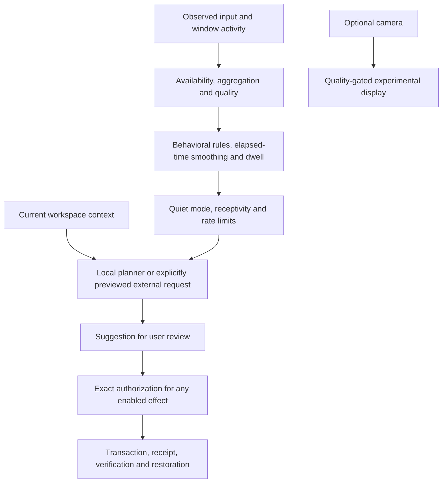

<p align="center">
  
</p>

<h1 align="center">Cortex — Local Workspace Support</h1>

<p align="center">
  A macOS app that turns local activity and workspace context into conservative,
  user-controlled suggestions. Optional camera estimates stay separate from support decisions.
</p>

<p align="center">
  <a href="https://github.com/StevenWang-CY/cortex/actions/workflows/ci.yml"></a>
  <a href="https://github.com/StevenWang-CY/cortex/releases/latest"></a>
  <a href="LICENSE"></a>
  
  
</p>

<p align="center">
  <a href="https://github.com/StevenWang-CY/cortex/releases/latest">Download</a> ·
  <a href="docs/README.md">Documentation</a> ·
  <a href="docs/release/0.5.1-validation.md">Current validation</a> ·
  <a href="CHANGELOG.md">Changelog</a> ·
  <a href="CONTRIBUTING.md">Contribute</a>
</p>

## In the app

These captures use **synthetic demonstration data**. They show the implemented
interface, not measured accuracy or a live person's workspace.

<table>
  <tr>
    <td width="50%" align="center" valign="top">
      
      <br/><sub><b>Desktop dashboard</b><br/>Evidence status and reachable session controls</sub>
    </td>
    <td width="50%" align="center" valign="top">
      
      <br/><sub><b>Suggestion review</b><br/>Keyboard access without unsolicited focus</sub>
    </td>
  </tr>
</table>

<p align="center">
  
  <br/><sub><b>Pulse Room</b> · Optional ambient motion and workspace resume cards</sub>
</p>

## Status

The source version is **0.5.1**, with behavioral model **2.6.0** and feature
schema **support-features-v2.2.0**. The [validation record](docs/release/0.5.1-validation.md)
separates completed checks from remaining release requirements. The download
badge describes the latest *published* release; a source tag alone does not
establish a signed, notarized macOS release.

Cortex remains **alpha research software**. Its support scores are explainable
heuristics, not calibrated probabilities or validated measures of stress,
attention or productivity. Webcam pulse is experimental and sensitive to
lighting, movement, camera and individual conditions. HRV, respiration, LF/HF,
apnea detection and physiology-triggered interventions remain disabled pending
reference-sensor validation. See [limitations](docs/limitations.md) and the
[model card](docs/model-cards/deterministic-support-v2.md).

## Key features

- **Local by default.** Deterministic planning needs no account, API key or model-network request. Camera frames are processed in memory.
- **Evidence-aware support.** Missing sensors abstain; observed inactivity stays distinct from absent data. Finite measurements, elapsed-time smoothing, continuous dwell and explicit unknown states keep the interpretation bounded.
- **User-controlled suggestions.** New and migrated installs use `suggest_only`. A proposal cannot change tabs, editors, windows or files. Any enabled effect requires an exact authorization, a durable receipt, verification and scoped restoration.
- **Optional external planning.** Bring your own credentials for AWS Bedrock, GCP Vertex, or the direct Anthropic API. Select sources, inspect the exact redacted request and provider caveat, then confirm that request once. Provider credentials alone never enable disclosure.
- **Connected workspace.** Chrome/Edge MV3 and VS Code integrations provide context, goal support, session summaries and resume cards. LeetCode mode adds stage-aware, user-controlled hints and submission review.
- **Consistent, accessible controls.** Shared visual tokens, keyboard review, compact scrolling, clear session actions, reduced-motion support and explicit stale/unavailable readings across the desktop and browser.

## How it works



The PySide6 app hosts the daemon in-process. Browser/editor clients use
capability-authenticated HTTP (`127.0.0.1:9472`) and WebSocket
(`127.0.0.1:9473`). Internal services communicate through typed application
interfaces. SQLite stores transactional authority and session records.

Camera physiology never establishes a support state or grants authority.
The behavior model uses fixed-denominator scores: removing evidence cannot
increase its contribution. Duplicate observations do not count again, gaps
above three seconds reset temporal confirmation, and display values expire
after ten seconds without a fresh update.

[Architecture](cortex/docs/architecture.md) · [API](cortex/docs/apis.md) ·
[Calibration](cortex/docs/calibration.md) · [UI design](cortex/docs/ui-design.md)

## Install

1. Download the matching `Cortex-<version>-macos-<arch>.dmg`, checksum manifest
   and evidence bundle from a [published release](https://github.com/StevenWang-CY/cortex/releases/latest).
   Choose `arm64` for Apple Silicon or `x86_64` for Intel.
2. Follow the [artifact verification instructions](docs/release/README.md#consumer-verification).
3. Open the DMG and drag **Cortex.app** into **Applications**, replacing an older
   copy if needed. Eject the disk image and launch `/Applications/Cortex.app`.
4. Follow the setup wizard for permissions, optional provider access,
   calibration, extensions and notifications. The app needs no separate
   Python or Node installation.
5. In **Connect Extensions**, install the browser integration, then fully quit
   the browser with **Cmd+Q** and reopen it. Reloading an extension is insufficient
   after native-host installation.

Closing the dashboard leaves Cortex in the menu bar. **End session** stops
sensing and shows a recap; **Start session** begins again. **Quit Cortex** exits
the app after cleanup. The browser's **Open Cortex** control launches the
installed app.

If startup fails, check `~/Library/Logs/Cortex/last-startup-error.txt` and
`~/Library/Logs/Cortex/startup.log`, then follow
[troubleshooting](wiki/Troubleshooting.md). Include the installed version and
diagnostic reference in a report. Do not reset camera permissions for all apps.

## Developer setup

Use the pinned toolchain: **Python 3.11.15**, **uv 0.10.12**, **Node 22.23.2** and
**pnpm 9.15.9**. CI also checks macOS Intel with Python 3.12.13. Apple Silicon
requires native ARM Python; verify with `python3 -c 'import platform; print(platform.machine())'`.

```bash
git clone https://github.com/StevenWang-CY/cortex.git
cd cortex
corepack prepare pnpm@9.15.9 --activate
make setup
make precommit
make dev
```

Optional configuration: `cp cortex/.env.example .env`. Generated template lines
are commented; uncomment only the settings you intend to change.

```bash
make verify           # full local source, test, build, replay and audit checks
make test             # Python suite; Qt tests run with profile isolation
make ext              # Chrome MV3 build
make ext-edge         # Edge MV3 build
make ext-dev          # browser development server
make dmg              # local ad-hoc macOS app and verified DMG
make help
```

`make verify` includes strict Python and TypeScript checks, Python branch
coverage and wheel inspection, schema/config/version/model/token drift, local
document links, browser/editor tests, both browser builds and size budgets,
VSIX packaging, recorded-trace replay and dependency-audit policy. Hosted CI
adds external link checks and the two-architecture matrix. Tests use isolated
profiles; hardware tests need their explicitly supplied fixtures.

For a source-development browser setup, load
`cortex/apps/browser_extension/build/chrome-mv3-prod/` at `chrome://extensions`,
then install the development native host and restart the browser:

```bash
uv run --project cortex --locked --extra dev --extra codegen \
  python -m cortex.scripts.install_native_host
```

See [setup](cortex/docs/setup.md), [configuration](cortex/docs/configuration-reference.md)
and the [package README](cortex/README.md) for the service layout and additional commands.

## Privacy and security

- Frames, landmarks, waveforms and raw physiological streams are excluded from the planner contract.
- Browser telemetry is metadata-only. Page-body excerpts require an explicit per-site grant and are never collected in incognito.
- External planning is off by default. Its one-time preview is tied to the exact selected sources and settings revision. Redaction cannot guarantee that arbitrary selected text contains no confidential information.
- Operational HTTP routes and the WebSocket handshake require a local capability token. `/health` is available for readiness probes. Token files use mode `0600`.
- Invalid inputs are rejected before execution. Validation errors retain field locations and request IDs without echoing rejected workspace content.

[Privacy](cortex/docs/privacy.md) · [Security model](cortex/docs/security.md) ·
[Report a vulnerability](SECURITY.md)

## Releases and evidence

Production distribution requires Developer ID signing, Apple notarization and
stapling, mounted-artifact verification, architecture-specific checksums,
SBOMs, GitHub attestations and the declared hardware-validation assurance tier.
Local ad-hoc builds are development artifacts. A failed Apple account or
notarization check blocks distribution; it is never replaced with a weaker
signing claim.

The [release guide](docs/release/README.md) explains the build and promotion
workflows. [Current validation](docs/release/0.5.1-validation.md), the
[changelog](CHANGELOG.md) and [historical audit ledger](audit/findings.md)
record the evidence and its limits.

## Contributing

Start with [CONTRIBUTING.md](CONTRIBUTING.md). Issues and patches are welcome;
security reports belong in [GitHub Security Advisories](https://github.com/StevenWang-CY/cortex/security/advisories/new).
This is a personal project with [best-effort support](SUPPORT.md).

## License

[MIT](LICENSE) © 2026 Steven Wang. Third-party attribution is listed in [NOTICE](NOTICE).
