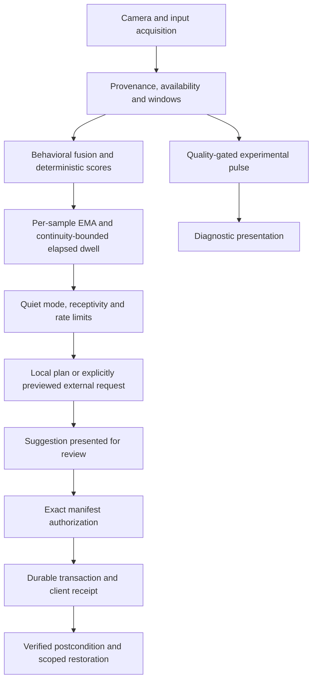

# Cortex: evidence continuity and complete interaction refinement

Review date: 2026-10-02. Baseline: `8edb71bdef468c677569af16c03bdbe14d1a1d53`,
`fix/v0.5.0-audit-cycle`. This is the current implementation specification;
the earlier [implementation history](../IMPLEMENTATION.md) remains intact.

## 1. Objective and evidence standard

Make the existing macOS application, Chrome/Edge extension and editor integration
reliably usable, consistent and honest about what they know. Implement only
changes justified by executable defects, a traced product path, or demonstrated
layout/interaction problems. Do not substitute a speculative classifier, a new
framework or a decorative redesign for measured improvements.

This review covers the application architecture, source algorithms, configuration,
generated contracts, storage/authorization boundaries, UI surfaces, tests,
documentation links and packaging. It uses source tracing, targeted reproductions,
the full existing automated gates and rendered UI inspection. It is not a proof
that every possible device, workload, accessibility technology or failure has
been tested. Software correctness, physiological validity, usability-study results
and release certification are separate claims.

At review start the working tree was clean. The `cortex` remote is the application
repository; `origin` is its wiki. The branch matched its remote tip and was 30
commits ahead of the locally recorded `cortex/main`; remote refs were also checked.
No branch reset, release publication or personal profile migration is required.

## 2. Current architecture and contracts to retain

| Layer | Active implementation | Review determination |
| --- | --- | --- |
| Composition | `application/kernel.py`, coordinators, service/event/status/data ports; `services/runtime_daemon.py` | Retain the local modular monolith. Transport adapters share domain state; improve task lifetime without replacing the whole daemon. |
| Acquisition | AVFoundation/OpenCV camera, bounded observation windows, MediaPipe landmarks, pynput input, foreground-window telemetry | Camera identity, continuity and quality are explicit. Input acquisition must gain equally explicit availability. |
| Physiology | `physio_engine/v2`, POS backend, raw spectral checks and publication gates | Keep experimental pulse separate from behavioral support inference. No basis to enable camera HRV, respiration, apnea or physiological stress triggers. |
| Behavioral inference | feature catalog/fusion, fixed-denominator rules, EMA/hysteresis/dwell, model registry | Preserve interpretable abstaining rules. Fix source missingness and temporal continuity before tuning thresholds. |
| Eligibility | trigger policy, receptivity, quiet mode, hourly limits and deterministic policy | Keep user preferences and interruption suppression authoritative; missing time cannot satisfy sustained evidence. |
| Context/planning | local context adapters, preview/redaction broker, typed draft, local validation and fallback | External requests remain off by default and exact-preview gated. A model response cannot grant action authority. |
| Effects | manifest authorization, durable transaction, client receipt, postcondition and scoped restore | Preserve exact one-time consent and restart recovery. UI review never bypasses authorization. |
| Persistence | single-owner SQLite, checksummed migrations, maintenance/retention/export, bounded analytics queue | No evidence warrants a storage rewrite. Retain durability and profile-isolated tests. |
| Interfaces | PySide6 desktop, Plasmo/React MV3 browser, VS Code extension, authenticated localhost API/WS | Refine shared state semantics and actual interaction defects. Avoid adding a second native/web UI framework. |
| Distribution | lockfiles, schema/config/token/model/version gates, wheel verifier, PyInstaller, nested signing and DMG verification | Build the changed application and both browser targets. A local artifact is not an independently validated public release. |

The camera stream uses observation provenance and dual clocks. Input events are
aggregated into behavioral windows. Fusion records missingness and window
readiness. Rules produce bounded heuristic strengths, not probabilities. EMA and
hysteresis determine the published support label; trigger policy decides whether
a proposal is appropriate. Context and planning follow that decision. Presentation,
authorization, execution, receipt and restoration are distinct stages.



The diagram intentionally has no physiology-to-action edge. The runtime remains
the composition/orchestration boundary; transport adapters cannot independently
promote a suggestion into authorization.

## 3. Algorithm screening and design alternatives

### 3.1 Acquisition availability is part of the measurement

An empty buffer is ambiguous: the user may be idle, the source may be disabled,
permission may be denied, or a listener may have stopped. The baseline starts
input listeners without using their success to qualify the aggregator's freshly
timestamped zeros. A device-free reproduction with hooks never started produced
an estimated under-engaged score of about 0.267 after 40 seconds and 0.70 after
300 seconds. Those values describe nonexistent evidence.

Required design: carry actual source availability through aggregation and fusion.
Only observed, supported channels count toward evidence. Retain valid passive
input inactivity when acquisition really is available. Partial listener failure
must not silently make the missing device look inactive. Availability transitions
must restart exposure rather than credit time spent disconnected. Permission and
listener checks must not record key content or request a new permission silently.
The same contract applies to calibration: unavailable mouse samples cannot enter
the personal baseline, while observed stationary mouse samples remain valid.

### 3.2 Dwell must mean sustained observed evidence

For scores `s`, smoothing uses an exponential update of the form
`s_t = alpha * x_t + (1 - alpha) * s_previous`, followed by entry/exit hysteresis
and elapsed-time candidate dwell. That design is understandable and testable;
changing to a learned temporal model is unjustified without labeled data.

The baseline clamps regressed time but still accepts its scores, and a candidate
observed at time 0 can commit after a single next observation at time 3600. An
observation gap is not an hour of corroborating evidence.

Required design: reject duplicate/regressed observations as new smoothing evidence;
invalidate the candidate, accumulated smoothing and committed-label dwell after
a documented maximum continuity gap; start a fresh confirmation interval on
return. Test gaps before and after commitment, recovery, invalid evidence and
ordinary continuous input. Choose the limit from the actual 500 ms pipeline
cadence and its existing freshness contracts, not from a claimed cognitive timescale.

### 3.3 Model provenance must include what determines the result

The baseline implementation hash covers feature definitions, registry, scorer and
inference wrapper, but excludes fusion and temporal smoothing. Changes to these
can change every published label while retaining the same implementation digest.
Expand the component manifest to the measurement/fusion/smoothing paths that
determine behavioral output; increment the behavioral model version and document
the compatibility/rollback boundary. Generated code must be regenerated, never
edited by hand. `safety_null` remains the fail-closed rollback option.

The resulting eleven-component manifest covers the telemetry schema, input hooks,
window tracker, aggregator, focus graph, fusion, smoother, feature catalog,
registry, scorer and inference wrapper. It is the behavioral inference code
identity, not a digest of the entire application or intervention policy. Reading
and goal check-in helpers, runtime wiring, configuration and personal calibration
are outside this manifest; reproducing a proposal also requires the corresponding
application revision, configuration and calibration context.

Three additional source-traced defects belong in the same correction. Typing
variance readiness in the baseline counts backspaces even though variance is computed
only from regular-key intervals; require two actually observed intervals before
publishing variance, including legitimate measured zero. The reading-reminder
path in the baseline changes eligibility using blink rate despite the diagnostic-only
camera boundary; make it behavior-only, with neutral copy and the conservative
120-second dwell. The goal-drift call reads a nonexistent top-level file path
instead of nested editor context and ignores the active browser title; wire
current task context correctly and abstain when it is unavailable. Test these
through their production callers, including camera invariance of proposals.

### 3.4 Physiology and personalization decisions

POS is a deterministic projection of normalized RGB changes designed around a
skin-reflection model. Its advantages here are inspectability and compatibility
with the existing quality/provenance harness. Learned rPPG is a legitimate
research alternative, but published benchmark performance does not establish
accuracy on this application's camera, frame timing, lighting and participants.
Retain POS and its spectral/noise/subharmonic gates. Do not tune thresholds from
papers or call synthetic tests clinical validation. Do not smooth a held pulse
into a new window while attributing it to a fresh measurement.

Personal calibration adjusts acquisition baselines and transforms; it cannot
validate a mental-state label. Keep fixed denominators and explicit coverage so
removing evidence cannot inflate confidence. Retain deterministic production
policy; separately consented micro-randomized trials are the appropriate route
to evaluating intervention benefit. Logged associations and propensity machinery
alone establish no causal improvement.

### 3.5 Architecture alternatives

| Alternative | Decision and reason |
| --- | --- |
| Replace rules with a neural classifier or online bandit | Defer: no representative held-out labels or intervention-benefit evidence. |
| Split the daemon into network services | Reject for this milestone: increases lifecycle, authentication and deployment burden for a local app. |
| Rewrite desktop in Swift/Electron | Reject: existing native PySide pathways and release contracts work; measured problems are local layout and interaction defects. |
| Keep every asyncio Task for diagnostics | Replace with live ownership plus bounded value-only completion history; completed tasks retain results, exceptions and coroutine references. |
| Use an unbounded cancellation wait behind a timeout | Reject: `wait_for` waits for cancellation to finish; explicitly bound waiting while retaining ownership of survivors. |
| Add global keyboard hooks to open a suggestion | Unnecessary: an explicit Review action in the focusable dashboard can activate the existing card without additional permissions. |
| Add motion to every control | Reject: repeated navigation and live telemetry need immediate, stable feedback. |

## 4. Reproduced interaction and runtime findings

| Before | After | Why |
| --- | --- | --- |
| New-tab state cache loses biometrics, capture and store fields | Preserve presentation fields and acquisition age in hydration | Newly opened and already open surfaces must agree. |
| Pulse Room keeps a truthy last pulse on unavailable/disconnected input | Finite, fresh pulse projection; clear immediately on invalidation; expire without updates | Old measurements must never look live. |
| Pulse beat drives an `aria-live` inhale/hold/exhale instruction | Stable signal status and accurate decorative-art description | Heartbeat art is not a breathing pacer or ECG. |
| Opt-out/restore can fail to restart its canvas; hidden/pause lifecycle is incomplete | One owned loop with persisted pause, hidden/reduced-motion/disabled stops and deterministic restart | Respect motion preferences and avoid wasted work. |
| Fixed-height new-tab content and absolute resume cards | Responsive composition and reachable controls at short heights/zoom | Preserve reading and action hierarchy in real windows. |
| Radio roles lack radio keyboard behavior | Roving tab stop plus arrow/Home/End controls | Semantics must match actual operation. |
| 380 px desktop connection/chip rows need up to 670 px | Wrap groups and provide scrollable consumer content | Real status combinations must not clip labels or actions. |
| Disconnect leaves desktop pulse/blink looking current | Clear stale values and display the connection/evidence state | Visual polish includes truthful data presentation. |
| Non-activating suggestion has mouse-only action access | Dashboard summary and explicit keyboard-operable Review path | Preserve non-interruptive arrival while making review accessible. |
| Browser popup declares stopped after a fixed two seconds | Settle Stop from verified worker/native outcome with retryable error | A disconnected client is not proof that the daemon stopped. |
| Native stop call timeout is shorter than the native graceful chain | Match bounded client budgets to actual shutdown stages | Avoid abandoning a still-running graceful shutdown or starting overlapping fallbacks. |
| The native Quit filter also consumes the final programmatic Quit; WebSocket mode routes ordinary window close into quit | Release the filter for committed quit and route explicit Quit consistently in both hosts | The packaged process must exit after cleanup, while closing the dashboard preserves the session. |
| Task supervisor retains completed background tasks until daemon shutdown | Bounded completion/failure records; active tasks remain owned | Long sessions should not retain every historical task and its payload. |

## 5. Visual and interaction specification

Apply [Emil Kowalski's design-engineering reference](https://github.com/emilkowalski/skills/)
as a decision framework across the existing design system. Preserve warm paper,
terracotta accents, restrained editorial display type and readable system-font
controls. Use generated semantic tokens rather than unrelated new palettes.
The upstream reference was checked at
`e8a175de22ae1e49370fc144c1f3bb9aeedf988d`; the relevant design-engineering,
Apple interaction and motion-review material informed the review, with the
concrete adaptation recorded in [the UI contract](../cortex/docs/ui-design.md).

The desktop hierarchy is connection/session status, support/evidence state,
readable metrics, current suggestion, then secondary diagnostics. Settings,
connection recovery and review remain discoverable with stable accessible names.
Long labels and all simultaneous badges must wrap without hiding actions. Native
keyboard navigation remains immediate. The unsolicited suggestion must not steal
focus; explicit Review may focus it and should place focus on a meaningful action.

Pulse Room is a quiet optional surface. Its signal status must explain whether
the daemon is disconnected, evidence is warming, capture is unavailable or a
fresh experimental pulse exists. Ambient artwork is decorative and hidden from
assistive technology. Persistent motion pause, new-tab opt-out and restoration
must work independently. Real content and resume actions remain in document flow
and reachable at narrow/short sizes. Honor dark mode, reduced motion and reduced
transparency. Continuous loops stop when hidden or unnecessary.

Keep functional transitions short and property-specific using existing tokens;
no `transition: all`, no scale-from-zero, no delays on keyboard navigation, no
bouncy live numbers and no animation merely because an element can animate.
Status regions announce meaningful state changes, not frame-by-frame counters.

## 6. Work packages and acceptance criteria

| Package | Required implementation | Acceptance |
| --- | --- | --- |
| A — evidence continuity | Actual input-source availability, exposure reset, missingness, temporal continuity/ordering, expanded versioned model identity | Device-free regression reproduces baseline failures; full inference/telemetry/replay/model/schema gates pass. |
| B — runtime ownership | Release finished task references; bounded diagnostics; deadline-respecting cancellation and truthful survivor ownership | High-volume completed tasks do not grow live registry; failure/critical-exit reporting retained; stubborn cleanup cannot hang deadline. |
| C — browser interaction | Shared pulse state projection, complete cache hydration, robust launch, motion lifecycle/pause, responsive layout, radio keyboard model | Fake-clock lifecycle/freshness tests, TypeScript, Vitest, Chrome/Edge builds and rendered inspection. |
| D — desktop interaction | Wrapping layout, scrollable consumer view, accurate disconnected metrics, suggestion summary and explicit review route | Offscreen minimum/normal-size screenshots and keyboard/state behavior tests; no real profile or camera use. |
| E — end-to-end Stop | Await actual stop result; consistent timeouts; truthful native/launcher outcomes; non-overlapping fallback | Delayed success, missing host, HTTP/auth failure, final survivor, repeated requests and UI retry are exercised without signaling real processes. |
| F — integration/build | Current documentation, local/primary-source links, full gates, packaged artifact and visual review | Record exact commands/outcomes; distinguish local build from signing/notarization/device certification. |

Implement A–E in independently owned files after this specification is saved.
Use focused regressions that fail for the demonstrated defects, then run the
full existing gates once against the integrated tree. Broaden tests only when a
new failure or change warrants it. Generated output stays generated; build
artifacts remain ignored. Do not alter real camera, browser installation,
permissions, Keychain, user preferences or stored sessions for automated tests.

### 6.1 Implemented contracts and regression ownership

| Contract | Implementation and exact bound | Regression evidence |
| --- | --- | --- |
| Input evidence | `input_hooks.py` reports actual per-device health; aggregator/fusion preserve per-source availability and restart exposure; calibration consumes only observed mouse samples | `test_algorithm_evidence_continuity.py`, `test_calibration_runner.py` |
| Typing readiness | `keystroke_interval_count` counts positive regular-key intervals; variance requires at least two intervals, independently of backspace count | Evidence continuity, state scoring and fusion tests |
| Temporal evidence | Nonincreasing observations are ignored; gaps above 3 seconds (six nominal pipeline ticks) reset accumulated scores, candidate and committed dwell | Duplicate, regression, pre/post-commit gap and continuous-evidence cases |
| Reading and goal check-ins | Behavior-only 120-second reading dwell; no source means abstention; foreground editor file/browser title reaches goal-drift evaluator; goal changes clear file history | Camera invariance, runtime caller and missing-context regressions |
| Identity | Model `2.5.0`, feature schema `support-features-v2.2.0`; eleven hashed components cover telemetry schema/acquisition/aggregation, focus graph, fusion, smoothing, feature catalog, registry, scorer and inference wrapper | Identity generator and both generated TypeScript drift gates |
| Background ownership | Live tasks remain strongly owned; value-only finished/failure deques each cap at 128; cancellation waits use a deadline and retain survivors | 400-result weak-reference test, expected cleanup exception, reused name, stubborn cleanup and coordinator restart |
| Browser signals | Shared ten-second continuity deadline; worker sends sample-age duration rather than an incompatible cross-context monotonic clock value; disconnect clears acquisition cache | Hydration parity, missing/invalid values, expiry, disconnect/reconnect |
| Browser motion | One owned canvas loop; persisted local pause; hidden/reduced-motion/disabled cleanup and restore | Lifecycle and accessibility suites plus rendered light/dark/compact states |
| Desktop review | Immutable pending proposal, original expiry bounded to five minutes and manifest lifetime, bounded retired-ID history; explicit focus only after Review; terminal invalidation clears queued action IDs | Presenter lifecycle, exact action dispatch, quiet state, once-only display counting and window-stop cases |
| Stop | Shared pending operation; graceful WS flush and authenticated HTTP, 20-second grace, 40-second native/fallback budgets; verify helper result rather than endpoint absence; 150-second UI watchdog includes pending launch | Delayed stop, denied signals, unknown process, native failure, retry and reopened popup |
| Launch/stop ordering | Invalidate pending launch continuation, drain its already-issued bounded helper request before process discovery, reject launch while stopping | Deferred launch response must not re-enable camera or enter another launch fallback |

The 3-second inference and 10-second presentation bounds solve different
problems. The former prevents gaps from earning inference dwell; the latter
prevents a disconnected UI stream from presenting a held estimate indefinitely.
Neither is evidence of physiological accuracy or cognitive-state validity.

### 6.2 Dependency and repository hygiene

The current audit identified patchable vulnerabilities outside the application
logic. Update only the affected packages within supported major ranges:
`urllib3` to 2.8.0, `virtualenv` to 21.7.13 and its required
`python-discovery` to 1.6.1; VS Code's transitive `brace-expansion`, `fast-uri`,
`markdown-it` and `undici` to patched releases. Persist security floors/overrides
and lockfiles so the next clean install preserves the repair.

Python and VS Code audits now report zero known findings. The browser build
chain retains nine existing reviewed exceptions (one low, eight moderate;
no high/critical findings); two exception IDs no longer returned by the current
audit were removed. A passing exception-policy gate is not a claim of zero
browser vulnerabilities. Replacing the Plasmo/Parcel/Svelte toolchain solely to
erase that report would introduce a separate migration and is not justified in
this refinement.

Untrack the pre-existing `.coverage` binary and ignore coverage output. Keep
source, tests, lockfiles and generated contract declarations reviewable; keep
DMGs, application bundles, browser builds, VSIXs and visual evidence untracked.

## 7. Validation and completion record

Verification covers Ruff; strict mypy; canonical Python tests with coverage and isolated
Qt tests; schema, config, tokens, versions and model provenance; deterministic
evaluation replay; browser TypeScript/Vitest/Chrome/Edge builds; VS Code
compile/Jest/package; wheel and macOS app/DMG build verification. Inspect rendered
desktop and browser states after the final relevant edit, including unavailable,
compact, long-content and motion-preference cases.

### Completed source validation

- Baseline canonical gate: 3,245 passed, 3 skipped; 68.89% branch-aware coverage.
- Final integrated canonical gate: **3,305 passed, 3 skipped**, 34 warnings,
  **69.32% coverage** against the unchanged 65% floor; Ruff and strict mypy pass
  (568 source files). Built wheel verified: 295 members.
- Algorithm review: 264 affected tests passed, 27 new algorithm regressions,
  calibration suite 11 passed. Nine representative new failures were reproduced
  against pristine baseline source before checking the fixes.
- Task lifetime: all four new regressions failed before the repair; 21 related
  lifetime/kernel/shutdown tests pass afterward. Native/launcher stop: all three
  new regressions failed before; the 28-test stop-chain suite passes afterward.
- Desktop: 22 new regressions; final focused lifecycle/dispatch run 45 passed,
  broader prior runs 96 and 100 passed, isolated legacy Qt harness 69 passed.
  All are included in the integrated gate where applicable.
- Packaged validation exposed a final-Quit interception defect missed by mocked
  event loops. Two real-Qt subprocess cases reproduced failure before repair;
  four final direct/native Quit cases pass across both desktop hosts. The
  follow-up lifecycle/startup/dashboard-stop suite passes all 33 tests. The
  final canonical run above includes these additional regressions.
- Repository contracts pass: local documentation links, config reachability,
  live message catalog, schema/model/token/version surfaces, action/tool pins
  and dependency/security boundaries.
- Recorded-trace evaluation remains unchanged: oscillation interventions 1.25
  per hour, sustained-overwhelm pass rate 1.0, flow-negative trigger rate 0.0,
  deterministic replay mismatch rate 0.0. These are fixture results, not human
  effectiveness measurements.
- Browser: **360 tests in 76 files** and TypeScript pass, including deferred
  HTTP/native launch races, shared launch ownership, stale presentation removal,
  retained recovery snapshots, popup reopening and fresh-session confirmation.
  Final Chrome/Edge production builds each contain 17 files and 838,326 bytes
  uncompressed; summed gzip size is 269,269 / 269,271 bytes respectively,
  within the unchanged size budgets.
- VS Code: 131 tests in 13 suites, lint, compilation and VSIX packaging pass.
  Node 22.23.2 matches `.node-version`; the downloaded official binary's
  published SHA-256 was checked before use.
- Public Markdown link screening covered 99 unique URLs: 84 returned successful
  HTTP responses directly; fourteen GitHub HTML endpoints returned 503 but all
  equivalent raw files returned 200; the NIST DOI was separately resolved to its
  official PDF after the batch client's failure. Local link contracts pass.

Two skipped tests require separately supplied UBFC/PURE checksum-bearing dataset
manifests; neither dataset was available for this run. The third skip is the
suite's global-`json2ts` PATH check; the dedicated real `generate_ts_schemas
--check` command passed for both clients using the repository-local generator.
Model identity, design-token and application-version checks also pass.

### Reproduction commands

Use the locked Python environment and the Node version in `.node-version`:

```bash
./cortex/scripts/run_python_gate.sh
cortex/.venv/bin/python -m cortex.scripts.verify_repository_contracts
cortex/.venv/bin/python -m cortex.scripts.generate_ts_schemas --check
cortex/.venv/bin/python -m cortex.scripts.generate_support_model_identity --check
cortex/.venv/bin/python -m cortex.scripts.sync_design_tokens --check
cortex/.venv/bin/python -m cortex.scripts.sync_versions --check
cortex/.venv/bin/python -m cortex.services.eval.regression_harness

(cd cortex/apps/browser_extension && pnpm exec tsc --noEmit && pnpm exec vitest run)
(cd cortex/apps/vscode_extension && npm run lint && npm run compile && npm test)
CORTEX_SIGN_IDENTITY=- CORTEX_REQUIRE_NOTARIZATION=0 CORTEX_NOTARIZE_PROFILE= \
  ./cortex/scripts/build_macos_app.sh
```

The last command builds Chrome and Edge extensions, the VSIX, the app and DMG,
then checks the actual mounted artifact. It is a local ad-hoc build. The
production signing/notarization and physical release-validation procedures in
`docs/release/` remain separate.

### Rendered inspection

Final desktop screenshots cover the normal and compact dashboard, simultaneous
badges, current suggestion, disconnect, settings permissions/privacy/expanded
weekly schedule and short onboarding/privacy. Browser screenshots cover light,
dark/reduced-motion, compact offline/retry, stale signals and paused motion.
Inspection confirms hierarchy, readable labels, reachable actions, no horizontal
settings overflow, and current-state clearing. These are synthetic UI fixtures,
not recordings of physiological performance or an end-user accessibility study.

### Packaged artifact and completion

All six work packages are implemented. The final build completed from the
changed working tree with application version `0.5.0` and behavioral model
`2.5.0`. No application-version bump or public release was performed.

- `dist/Cortex.app` and `dist/Cortex-0.5.0-macos-arm64.dmg` are built, with both
  production browser targets and the compiled VSIX bundled.
- Mounted DMG verification **passed**: arm64 identity, GUI plist flags,
  installer layout, secret/forbidden-pattern scan, strict nested signatures,
  native-host protocol, frozen resources and model identity, full healthy
  headless application startup, SIGTERM exit code 0 and closed listeners.
  The probe uses an isolated HOME and disables hardware acquisition.
- A separate restart probe launched the built app twice against the **same**
  isolated HOME, storage and ephemeral ports. Both runs became healthy and
  exited with code 0 after SIGTERM, released both listeners and emitted no
  forbidden camera/fatal markers. The second run retained the first run's
  storage files and received a new boot ID. Evidence is saved in
  `dist/review-2026-10/restart-probe.json`.
- The final DMG SHA-256 is
  `2fc141cbe098b7ff5e9506d41c90ce6b42665d99298f3cb3d2af7104fc1ecc07`.
  Machine-readable verification, build metadata and checksums are under
  `dist/evidence-review-2026-10-arm64/`.
- Fifteen inspected screenshots, gate/audit logs and the source-change manifest
  are preserved under `dist/review-2026-10/`. They are local review evidence and
  intentionally ignored by Git. The source manifest records content hashes
  against the baseline commit so an uncommitted build is not mistaken for an
  immutable release tag.
- The unchanged branch retains the complete source diff for review. No commit,
  push, installed-app replacement or public deployment was performed.

This is an **ad-hoc development build**. Developer ID notarization, Gatekeeper
distribution approval, an Intel artifact, and physical camera/TCC/VoiceOver
validation were not established by this local arm64 run. The optional public
physiology datasets were not available; heuristic support labels and webcam
pulse retain the limits in the model card. These are explicit external release
and research requirements, not silently passed implementation checks.

A failed gate must be repaired or reported precisely; an unperformed check is never a pass.
Physical camera/TCC permutations, reference-sensor accuracy, independent review,
human usability studies and public-release assurance remain separately evidenced.

## 8. Documentation closeout

The documentation pass reconciles the current implementation across the
[documentation index](README.md), both repository/package READMEs and the
canonical architecture, API, adapter, calibration, model-card, privacy,
security, setup, UI and release guides. It also updates contributor/support
instructions, local wiki pages, the plan index and audit-log entry points.
Generated configuration references remain generator-owned; accepted ADRs,
historical plans and commit-bound verification records retain their original
evidence rather than inheriting new results.

Corrections include camera-independent behavioral inference, source
availability and continuous dwell, calibration activation, task ownership,
preview-bound disclosure, verified shutdown, the separate desktop host modes,
signal freshness, motion controls and explicit suggestion review. Development
examples use the locked toolchain and distinguish the full Python gate from
`make ci`. Screenshots in the main README now show the inspected implemented
interface and label their synthetic readings; the older automatic-tab-closing
demo is marked historical and removed from the current overview.

These Markdown and documentation-image changes followed the verified build;
they do not change its application code. The original build-source manifest is
preserved as `dist/review-2026-10/source-change-manifest-build.json`. The updated
`source-change-manifest.json` records the final documentation hashes and checks
that application sources still match the built snapshot. Documentation
verification consists of the repository contract/local-link gate and
`git diff --check`; it is not a rerun of the earlier runtime test suites.
Local wiki edits remain unpublished until a separate publication action.

## 9. Primary research and implementation references

- [POS: Algorithmic Principles of Remote PPG](https://research.tue.nl/en/publications/algorithmic-principles-of-remote-ppg/): mechanism and assumptions; does not validate Cortex's population or camera path.
- [rPPG-Toolbox, NeurIPS 2023](https://proceedings.neurips.cc/paper_files/paper/2023/hash/d7d0d548a6317407e02230f15ce75817-Abstract-Datasets_and_Benchmarks.html): reproducible comparison infrastructure for learned and unsupervised methods; motivates held-out evaluation before replacement.
- [Micro-randomized trials](https://pmc.ncbi.nlm.nih.gov/articles/PMC4732571/): intervention availability, randomization and proximal outcomes; supports retaining a separate research path.
- [Python asyncio tasks](https://docs.python.org/3/library/asyncio-task.html): task references, cancellation and waiting semantics; grounds bounded ownership and teardown.
- [pynput platform limitations](https://pynput.readthedocs.io/en/latest/limitations.html): operating-system permissions and input-capture limitations; a created listener is insufficient evidence that keyboard input is observable.
- [Chrome extension worker lifecycle](https://developer.chrome.com/docs/extensions/develop/concepts/service-workers/lifecycle): workers terminate and restart; presentation caches and stop intent must survive coherently.
- [WCAG 2.2: Pause, Stop, Hide](https://www.w3.org/WAI/WCAG22/Understanding/pause-stop-hide.html): user control of ongoing motion; reduced-motion support complements an explicit pause control.
- [Emil's design-engineering skills](https://github.com/emilkowalski/skills/): interaction restraint, purposeful motion, typography and edge-case review; adapted to Cortex's existing tokens and native platform.
- [WAI-ARIA radio group pattern](https://www.w3.org/WAI/ARIA/apg/patterns/radio/): keyboard behavior for the quiet-mode selector; checked alongside rendered and DOM behavior.
- [urllib3 advisory](https://github.com/urllib3/urllib3/security/advisories/GHSA-vxq7-64xx-v4gw) and [virtualenv advisory](https://github.com/pypa/virtualenv/security/advisories/GHSA-p58f-9548-mpm2): upstream patched-version evidence for Python security floors.
- [brace-expansion](https://github.com/juliangruber/brace-expansion/security/advisories/GHSA-q2hr-2g5m-vwhr), [fast-uri](https://github.com/fastify/fast-uri/security/advisories/GHSA-hrr3-gc8f-f4qj), [markdown-it](https://github.com/markdown-it/markdown-it/security/advisories/GHSA-253c-mchw-3w2r), and [undici](https://github.com/nodejs/undici/security/advisories/GHSA-w293-vg96-wgc3): upstream evidence for compatible VS Code toolchain patches.

The references justify mechanisms and evaluation choices, not measured product
efficacy. Existing [limitations](limitations.md), [model card](model-cards/deterministic-support-v2.md)
and [study protocol](research/support-inference-study-protocol.md) remain binding.
